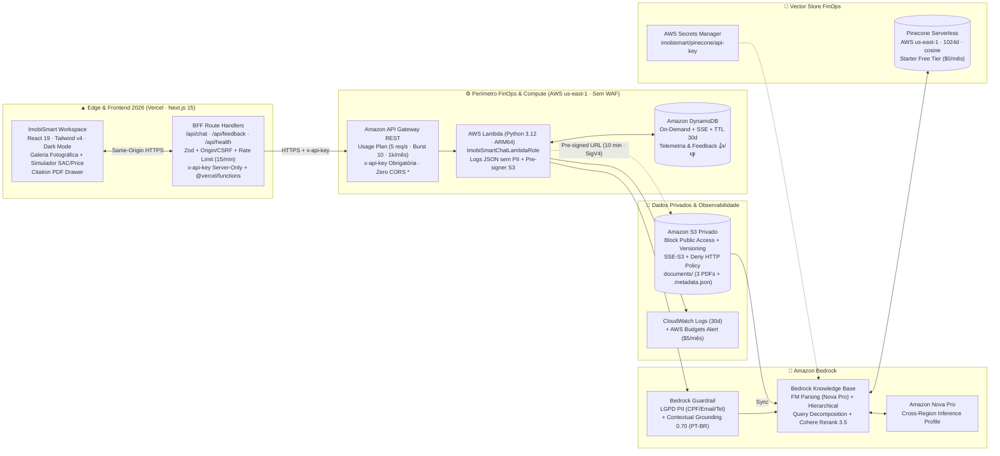

# 🏢 ImobiSmart AI — Central de Inteligência Imobiliária (AWS Well-Architected RAG)

> **Copiloto técnico-comercial RAG pronto para produção** para consulta de empreendimentos, memoriais descritivos, convenção condominial e financiamento habitacional — arquitetado sob os **6 Pilares do AWS Well-Architected Framework**, com **DevSecOps / Menor Privilégio Rígido**, **FinOps (~97% de economia vs. OpenSearch Serverless)** e **Frontend PropTech 2026 em Next.js 15 + BFF Seguro (Security Headers Nota A+)**.

---

## 📐 1. Arquitetura em Produção



---

## 🛡️ 2. Destaques de Engenharia, Segurança & FinOps

### AWS Well-Architected & DevSecOps
- **IAM Menor Privilégio Rígido ([ADR-004](docs/architecture/adr/ADR-004-devsecops-e-iam-menor-privilegio.md)):** duas roles segregadas (`ImobiSmartBedrockKBRole` com proteção anti-*Confused Deputy* via `aws:SourceAccount`/`aws:SourceArn` + `ImobiSmartChatLambdaRole` com ARNs exatos para KB, Nova Pro, Cohere Rerank 3.5, Guardrail, DynamoDB e leitura restrita a `documents/*`).
- **S3 Privado com Pre-signed URLs Temporárias:** bucket com *Block All Public Access*, versionamento ativo, criptografia AES-256 (`SSE-S3`), política `DenyInsecureTransport` (HTTPS obrigatório) e geração sob demanda de URLs assinadas SigV4 válidas por **10 minutos** com trava contra *path traversal*.
- **Proteção LGPD & Anti-Alucinação:** Amazon Bedrock Guardrail no tier `Standard` (suporte a Português) bloqueando PII (`CPF_BR`, `EMAIL`, `PHONE`) e validando *Contextual Grounding* (`0.70`).
- **Defesa contra *Denial of Wallet* sem AWS WAF ([ADR-002](docs/architecture/adr/ADR-002-rate-limiting-finops-sem-waf.md)):** 4 camadas gratuitas — BFF Rate Limiting (`15 req/min`), API Gateway Usage Plan (`5 req/s`, `Burst 10`, `Quota 1.000/mês`, `x-api-key`), validação estrita de payload (máx. 1.000 chars) e **AWS Budgets Alert**.
- **Security Headers Nota A+ no Frontend ([next.config.ts](apps/web/next.config.ts)):** `Content-Security-Policy` estrita (`connect-src 'self'`, `frame-ancestors 'none'`, `frame-src` restrito ao S3), `Strict-Transport-Security (preload)`, `X-Frame-Options: DENY`, `X-Content-Type-Options: nosniff`, `Referrer-Policy`, `Permissions-Policy`, `COOP`/`CORP` e remoção de `X-Powered-By`.
- **Padrão BFF Anti-CSRF ([ADR-003](docs/architecture/adr/ADR-003-cors-restritivo-e-padrao-bff.md)):** validação de `Origin` e `Sec-Fetch-Site`, bloqueio de `Content-Type` inválido (`415`) e payload > 4 KB (`413`); a `x-api-key` nunca chega ao navegador.
- **CI/CD DevSecOps & Deploy Keyless via OIDC ([ADR-007](docs/architecture/adr/ADR-007-estrategia-containers-e-ci-cd.md)):** GitHub Actions com Gitleaks, Ruff, Bandit, `unittest` em Python 3.12 (paridade Linux com Lambda), `typecheck`/`build`/`npm audit` em Node 22, `cfn-lint` + `checkov` em `infra/template.yaml` e deploy CloudFormation via **GitHub OIDC → IAM Role** (zero chaves AWS estáticas).

### FinOps — Economia Real > 97% no Custo Fixo

| Camada | Abordagem Tradicional (PoC) | Arquitetura ImobiSmart AI |
| :--- | :--- | :--- |
| **Vector Database** | OpenSearch Serverless: ~US\$ 350–700/mês | **Pinecone Serverless Starter: US\$ 0,00/mês** |
| **Proteção de Borda** | AWS WAF: ~US\$ 6–15+/mês | **API GW Usage Plan + BFF Vercel: US\$ 0,00/mês** |
| **Hospedagem Frontend** | Streamlit em EC2/App Runner: ~US\$ 15–30/mês | **Vercel Hobby (Next.js 15): US\$ 0,00/mês** |
| **Compute, Storage & IA** | Pay-per-use | **Secrets Manager (US\$ 0,40) + Bedrock/Lambda `arm64`/DynamoDB sob demanda** |
| **Total Estimado (Piloto)** | **~US\$ 375 – US\$ 750 / mês** | **~US\$ 2,50 – US\$ 11,50 / mês** |

---

## 📋 3. Registro de Decisões de Arquitetura (ADRs)

Todas as decisões arquiteturais estão documentadas em [docs/architecture/adr/](docs/architecture/adr/README.md):

| ADR | Decisão |
| :--- | :--- |
| [ADR-001](docs/architecture/adr/ADR-001-vector-store-pinecone-serverless.md) | Pinecone Serverless + FM Parsing + Cohere Rerank 3.5 em vez de OpenSearch Serverless |
| [ADR-002](docs/architecture/adr/ADR-002-rate-limiting-finops-sem-waf.md) | Rate Limiting em 4 camadas e proteção contra *Denial of Wallet* sem AWS WAF |
| [ADR-003](docs/architecture/adr/ADR-003-cors-restritivo-e-padrao-bff.md) | Política de CORS restritiva (zero `*`) e padrão BFF na Vercel |
| [ADR-004](docs/architecture/adr/ADR-004-devsecops-e-iam-menor-privilegio.md) | Práticas DevSecOps *Shift-Left* e IAM com Menor Privilégio Rígido |
| [ADR-005](docs/architecture/adr/ADR-005-fonte-canonica-kb-3-pdfs.md) | Fonte Canônica da Base de Conhecimento (3 PDFs oficiais + sidecars `.metadata.json`) |
| [ADR-006](docs/architecture/adr/ADR-006-frontend-2026-nextjs-vercel-ai-sdk.md) | Substituição do Streamlit por Next.js 15 + React 19 + Tailwind CSS v4 |
| [ADR-007](docs/architecture/adr/ADR-007-estrategia-containers-e-ci-cd.md) | Estratégia Serverless-First (sem Docker) e CI/CD DevSecOps com GitHub OIDC |

---

## 🗂️ 4. Estrutura do Monorepo

```text
imobismart-ai/
├── .agent/                       # Governança Google Antigravity (rules, workflows /, skills)
├── .github/workflows/            # CI DevSecOps (Gitleaks, Ruff, Bandit, Checkov) + Deploy AWS OIDC
├── apps/web/                     # Frontend PropTech 2026 (Next.js 15 + Tailwind v4 + BFF Seguro)
│   ├── public/images/properties/ # Fotografias arquitetônicas locais (self-hosted, CSP 'self')
│   └── src/
│       ├── app/api/              # BFF Route Handlers (/api/chat, /api/feedback, /api/health)
│       ├── components/           # Sidebar fotográfica, PropertyBriefCard, Simulador SAC/Price, CitationDrawer
│       └── lib/                  # Hardening BFF (Origin/CSRF/RateLimit), portfólio e formatador WhatsApp
├── backend/                      # Serverless Python 3.12 (ARM64 Graviton)
│   ├── src/handlers/             # Lambda HTTP Router (/v1/health, /v1/chat, /v1/feedback)
│   ├── src/services/             # Bedrock RAG (Query Decomposition + Rerank), S3 Pre-signer, DynamoDB Store
│   ├── src/schemas/              # Validação estrita de contratos
│   └── tests/                    # 10 testes unitários automatizados (unittest)
├── infra/                        # Infrastructure as Code (CloudFormation + deploy.ps1)
├── knowledge-base/               # 3 PDFs oficiais (IMOBI-EMP-001, COND-002, FIN-003) + .metadata.json + sync_kb.ps1
└── docs/
    ├── architecture/adr/         # 7 ADRs formais
    ├── evaluation/               # Golden Dataset (13 casos) + runner automatizado
    └── evidence/                 # Evidências QA (.mp4 e screenshots de produção)
```

---

## 🚀 5. Execução & Deploy

### 5.1 Testes Unitários & Deploy do Backend (AWS CloudFormation)
```powershell
# 1) Sincronizar os 3 PDFs + metadados no S3
.\knowledge-base\scripts\sync_kb.ps1 -BucketName "<SEU_BUCKET_S3>"

# 2) Rodar testes unitários (10/10), validar CloudFormation e fazer deploy da stack
.\infra\deploy.ps1 `
  -DocsBucketName "<SEU_BUCKET_S3>" `
  -KnowledgeBaseId "<SEU_KB_ID>" `
  -GuardrailId "<SEU_GUARDRAIL_ID>"
```

### 5.2 Frontend Local (`apps/web`)
Crie `apps/web/.env.local` baseado em [.env.example](.env.example) e execute:
```powershell
cd apps/web
npm install
npm run build
npm run start
```
Acesse `http://localhost:3000`.

### 5.3 Deploy em Produção na Vercel
1. Importe o repositório na **Vercel** definindo **Root Directory** = `apps/web`.
2. Configure as variáveis de ambiente server-side (nunca use `NEXT_PUBLIC_`):
   - `AWS_API_BASE_URL` = URL base do API Gateway (`/prod`)
   - `AWS_API_KEY` = valor da chave do Usage Plan (`imobismart-bff-key-prod`)
   - `ALLOWED_ORIGINS` = `https://<seu-dominio>.vercel.app`
   - `RATE_LIMIT_MAX_REQUESTS` = `15` | `RATE_LIMIT_WINDOW_SECONDS` = `60`
3. Após obter a URL HTTPS da Vercel, atualize o parâmetro `AllowedOrigins` na stack AWS executando novamente `.\infra\deploy.ps1 -AllowedOrigins "https://<seu-dominio>.vercel.app"`.

### 5.4 Modo Portfólio FinOps (`DEMO_MODE=true` — US\$ 0/mês sem AWS ativa)
Caso queira desligar ou remover a infraestrutura AWS após demonstrações e ainda manter o site 100% navegável na Vercel:
1. Remova as variáveis `AWS_API_BASE_URL` e `AWS_API_KEY` nas *Environment Variables* da Vercel.
2. Defina `DEMO_MODE=true` (server-only) e faça redeploy na Vercel.
3. O site preserva todos os controles de segurança (CSP/HSTS, Origin/CSRF, Rate Limit, Zod), exibe o selo **Modo Demo · FinOps**, mantém portfólio + Simulador SAC/Price ativos e responde no chat com citações verídicas (documento + página) e simulação do Guardrail LGPD.

### 5.5 Evidências de QA End-to-End (`.mp4` e Screenshots)
Consulte [docs/evidence/README.md](docs/evidence/README.md) para assistir às gravações reais de navegação, simulador SAC/Price, filtros Pinecone, Dark Mode e consultas RAG ao vivo com abertura de PDFs S3 em `#page=N`.

---

## 👤 Autor & Licença
- **Autor:** Caio Cesar
- **Licença:** MIT — consulte [LICENSE](LICENSE).
