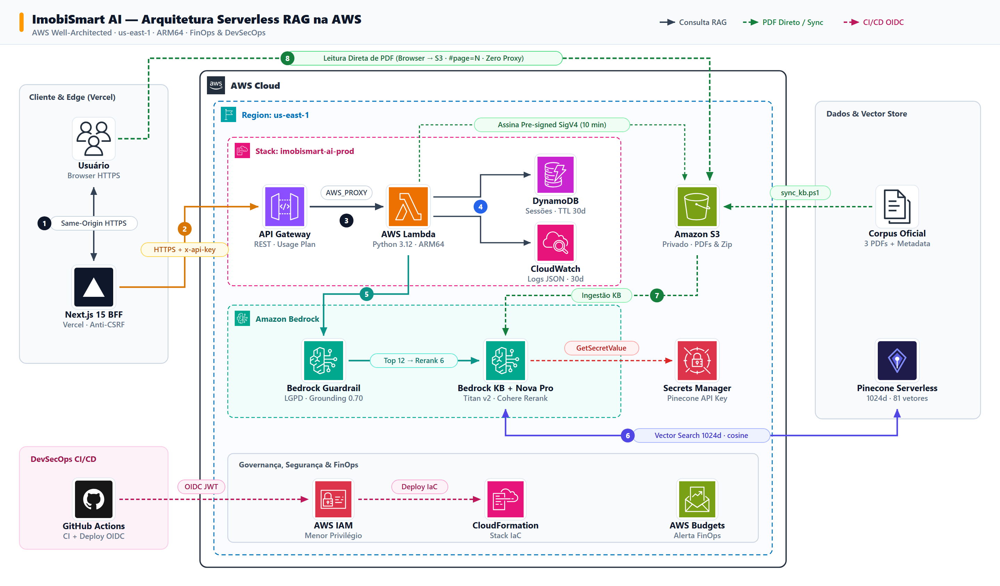
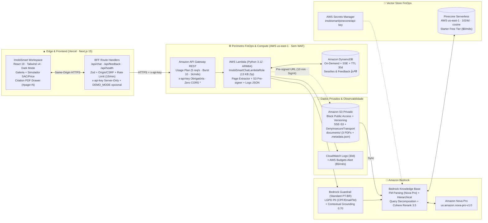
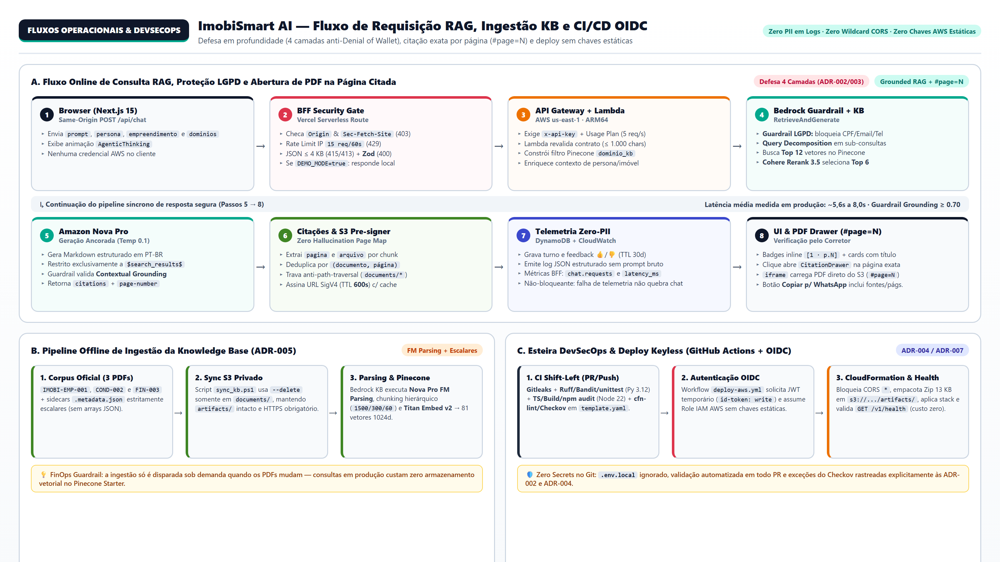
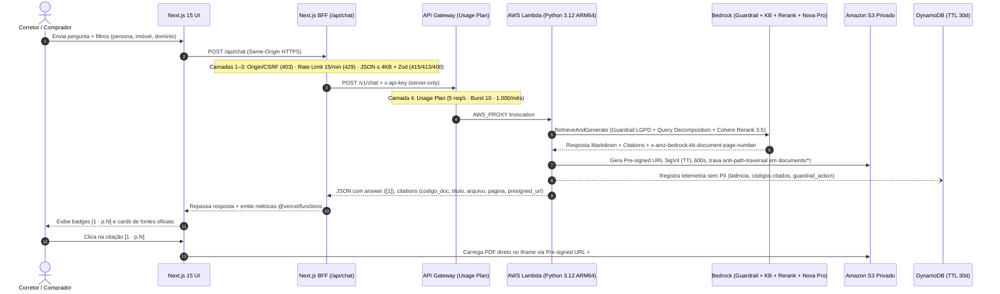
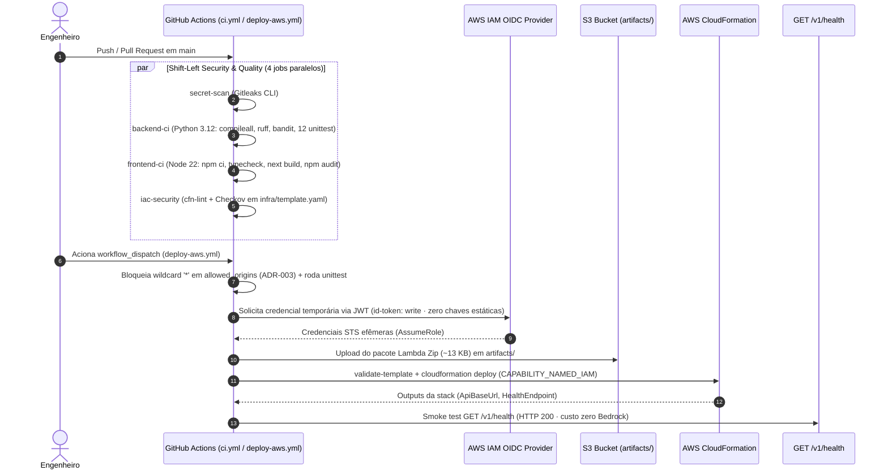
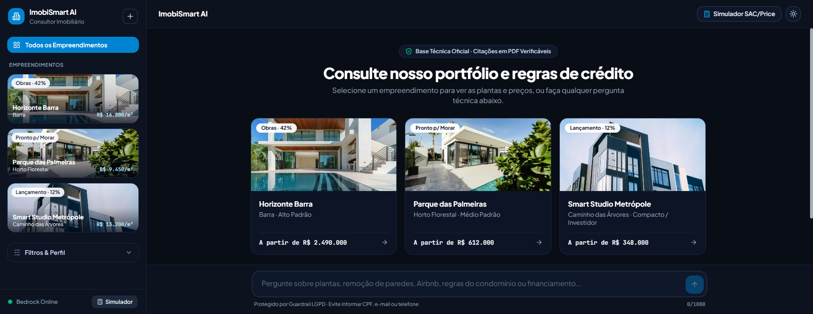
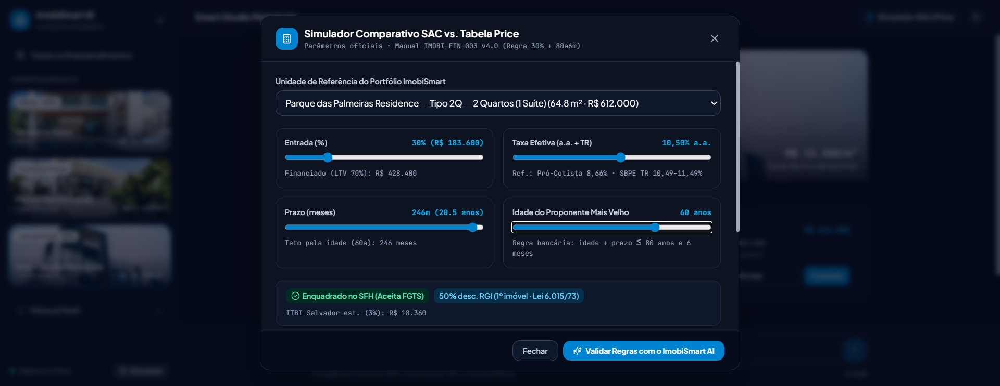
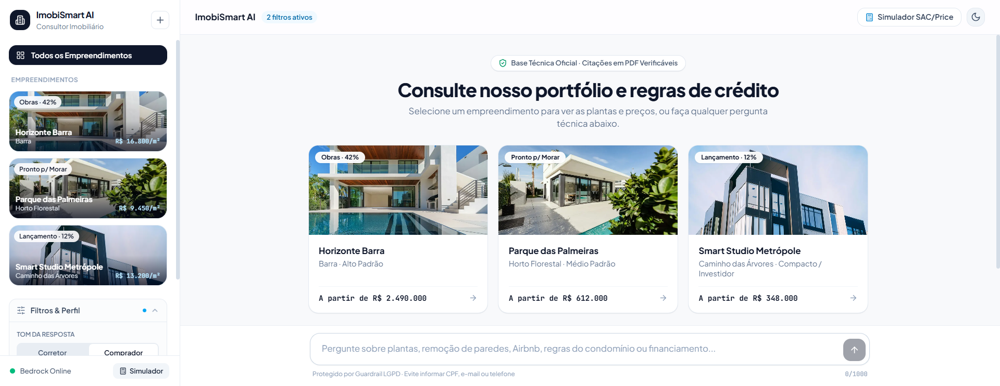
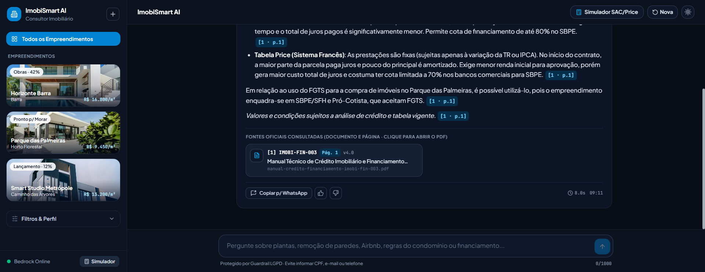

# 🏢 ImobiSmart AI — Central de Inteligência Imobiliária (AWS Well-Architected RAG)

[](https://github.com/caiocesarti/aws-serverless-rag-reference/actions/workflows/ci.yml)


[](https://youtu.be/37uelSDcW_Q)

> **Arquitetura de Referência Serverless RAG (Piloto Funcional)** aplicada a um **estudo de caso do setor imobiliário** (corpus técnico sintético de 3 PDFs) — implementada end-to-end na AWS (`us-east-1`) e Next.js 15 seguindo os **6 pilares do AWS Well-Architected Framework**, com **citações por documento e página (`#page=N`)**, **IAM de menor privilégio**, **DevSecOps** e **FinOps**.

**Navegação rápida:** [Visão Geral](#-1-visão-geral--funcionalidades) · [Arquitetura AWS (PNG)](#-2-arquitetura-aws-well-architected) · [Fluxos & Sequências](#-3-diagramas-de-fluxo-rag-segurança--cicd) · [6 Pilares & FinOps](#-4-aws-well-architected-framework--finops) · [ADRs](#-5-registro-de-decisões-de-arquitetura-adrs) · [Evidências em Produção (Vídeo)](#-6-evidências-em-produção-na-aws-vídeo--screenshots) · [Stack & Monorepo](#-7-stack-verificada--estrutura-do-monorepo) · [Replicar do Zero](#-8-passo-a-passo-para-replicar-o-projeto) · [Como Testar](#-9-guia-de-testes-e-verificação) · [Escopo & Limites](#-10-escopo-do-piloto--evolução-para-escala)

---

## 🎯 1. Visão Geral & Funcionalidades

Este projeto é um **piloto funcional e arquitetura de referência** construído sobre um estudo de caso fictício (*ImobiSmart Incorporadora — Salvador/BA*), com um corpus sintético controlado de 3 documentos técnicos em PDF (catálogo de plantas, convenção de condomínio e manual de crédito). O objetivo é demonstrar, em código e infraestrutura reais, como estruturar um assistente **RAG multi-documento** com rastreabilidade de fontes, controles de segurança e baixo custo operacional:

- **Consultas Multi-Documento com Reranking:** Amazon Bedrock Knowledge Base (*FM Parsing* com Nova Pro + *Hierarchical Chunking* `1500/300/60` + *Query Decomposition*) sobre Pinecone Serverless (`1024d`, *cosine*) com **Cohere Rerank 3.5** (`top 12 → 6`) e geração via **Amazon Nova Pro** (`temperature: 0.1`).
- **Citações com Documento, Página e Deep-Link `#page=N`:** extração determinística de `x-amz-bedrock-kb-document-page-number`, marcações inline `[1 · p.N]`, cards de fontes com título/arquivo `.pdf` e inspetor lateral (`CitationDrawer`) abrindo o PDF do S3 privado direto na página citada via **Pre-signed URL SigV4 (10 min)**.
- **Proteção LGPD & Controle de Alucinação:** Amazon Bedrock Guardrail (`Standard`, PT-BR) bloqueando PII (`CPF_BR`, `EMAIL`, `PHONE`) e validando *Contextual Grounding* (`≥ 0.70`).
- **Portfólio Fotográfico & Simulador SAC vs. Tabela Price:** 3 empreendimentos do estudo de caso (*Residencial Horizonte Barra*, *Parque das Palmeiras Residence*, *Smart Studio Metrópole*) com enquadramento automático **SFH/FGTS vs. SFI**, desconto de 50% no 1º RGI (Lei 6.015/73), estimativa de ITBI (3%), alerta de LTV > 70% na Price e regra etária (`idade + prazo ≤ 80 anos e 6 meses`).
- **Apoio ao Corretor & Standby FinOps:** filtros por persona (`Corretor`/`Comprador`) e domínio Pinecone, formatação para **WhatsApp** (com fontes/páginas), feedback 👍/👎 no DynamoDB e flag opcional **`DEMO_MODE=true`** para manter a interface navegável na Vercel a **US\$ 0,00/mês** quando a stack AWS estiver desligada.

---

## 🏛️ 2. Arquitetura AWS Well-Architected



<details>
<summary>Ver versão em texto (Mermaid) da arquitetura</summary>



</details>

---

## 🔄 3. Diagramas de Fluxo (RAG, Segurança & CI/CD)



### 3.1 Fluxo de Sequência — Consulta RAG Segura & Abertura de PDF em `#page=N`



### 3.2 Fluxo de Sequência — Esteira DevSecOps & Deploy Keyless (GitHub OIDC)



---

## 🛡️ 4. AWS Well-Architected Framework & FinOps

### 4.1 Mapeamento dos 6 Pilares

| Pilar Well-Architected | Implementação Concreta no ImobiSmart AI | Referência |
| :--- | :--- | :--- |
| **1. Excelência Operacional** | Infraestrutura 100% IaC em CloudFormation (`infra/template.yaml`), deploy automatizado via `deploy.ps1` e GitHub Actions OIDC, logs JSON estruturados sem PII, métricas `@vercel/functions`, governança `.agent/` (regras, workflows `/` e skills) e 12 testes unitários automatizados. | [ADR-004](docs/architecture/adr/ADR-004-devsecops-e-iam-menor-privilegio.md), [ADR-007](docs/architecture/adr/ADR-007-estrategia-containers-e-ci-cd.md) |
| **2. Segurança** | Duas roles IAM segregadas de menor privilégio (trust policy anti-*Confused Deputy* via `aws:SourceAccount`/`aws:SourceArn`), S3 privado (*Block Public Access*, `SSE-S3`, `DenyInsecureTransport`, Pre-signed URL 10 min com trava anti-*path traversal*), BFF sem `x-api-key` no browser, Security Headers restritivos (`CSP`, `HSTS`, `X-Frame-Options: DENY`), zero CORS `*` e Bedrock Guardrail LGPD. | [ADR-003](docs/architecture/adr/ADR-003-cors-restritivo-e-padrao-bff.md), [ADR-004](docs/architecture/adr/ADR-004-devsecops-e-iam-menor-privilegio.md) |
| **3. Confiabilidade** | Serviços 100% gerenciados e Multi-AZ nativos (API Gateway, Lambda, DynamoDB On-Demand, S3 Versionado, Bedrock), fallback automático de `sessionId` desconhecido no Bedrock, telemetria DynamoDB não-bloqueante e fonte canônica de 3 PDFs sem conflitos. | [ADR-005](docs/architecture/adr/ADR-005-fonte-canonica-kb-3-pdfs.md) |
| **4. Eficiência de Performance** | Lambda Python 3.12 em **ARM64 (Graviton)** com pacote enxuto de **~13 KB** (sem container pesado), Cohere Rerank 3.5 + Query Decomposition, cache de Pre-signed URL por arquivo e Next.js 15 App Router com imagens self-hosted e modal lazy-loaded (`next/dynamic`). | [ADR-006](docs/architecture/adr/ADR-006-frontend-2026-nextjs-vercel-ai-sdk.md), [ADR-007](docs/architecture/adr/ADR-007-estrategia-containers-e-ci-cd.md) |
| **5. Otimização de Custos (FinOps)** | Pinecone Serverless Starter (**US\$ 0/mês** vs. ~US\$ 350–700 do OpenSearch Serverless), defesa anti-*Denial of Wallet* em 4 camadas **sem AWS WAF**, AWS Budgets Alert (US\$ 5/mês), retenção 30d (CloudWatch/DynamoDB TTL) e `DEMO_MODE=true` na Vercel (**US\$ 0/mês** em standby). | [ADR-001](docs/architecture/adr/ADR-001-vector-store-pinecone-serverless.md), [ADR-002](docs/architecture/adr/ADR-002-rate-limiting-finops-sem-waf.md) |
| **6. Sustentabilidade** | Arquitetura 100% Serverless *scale-to-zero* (nenhuma instância EC2, NAT Gateway ou ECS Fargate ociosa 24/7) executando compute em processadores **AWS Graviton (ARM64)** de maior eficiência energética. | [ADR-007](docs/architecture/adr/ADR-007-estrategia-containers-e-ci-cd.md) |

### 4.2 FinOps — Economia Real > 97% no Custo Fixo

| Camada | Abordagem Tradicional (PoC) | Arquitetura ImobiSmart AI |
| :--- | :--- | :--- |
| **Vector Database** | OpenSearch Serverless: ~US\$ 350–700/mês | **Pinecone Serverless Starter: US\$ 0,00/mês** |
| **Proteção de Borda** | AWS WAF: ~US\$ 6–15+/mês | **API GW Usage Plan + BFF Vercel: US\$ 0,00/mês** |
| **Hospedagem Frontend** | Streamlit em EC2/App Runner: ~US\$ 15–30/mês | **Vercel Hobby (Next.js 15): US\$ 0,00/mês** |
| **Compute, Storage & IA** | Instâncias 24/7 + Pay-per-use | **Secrets Manager (US\$ 0,40) + Bedrock/Lambda `arm64`/DynamoDB sob demanda** |
| **Total Estimado (Piloto)** | **~US\$ 375 – US\$ 750 / mês** | **~US\$ 2,50 – US\$ 11,50 / mês** *(ou **US\$ 0,00/mês** em `DEMO_MODE=true`)* |

---

## 📋 5. Registro de Decisões de Arquitetura (ADRs)

Todas as decisões e trade-offs estão formalmente documentados em [docs/architecture/adr/](docs/architecture/adr/README.md):

| ADR | Decisão | Pilares Principais |
| :--- | :--- | :--- |
| [ADR-001](docs/architecture/adr/ADR-001-vector-store-pinecone-serverless.md) | Pinecone Serverless + FM Parsing + Cohere Rerank 3.5 em vez de OpenSearch Serverless | FinOps, Performance, Sustentabilidade |
| [ADR-002](docs/architecture/adr/ADR-002-rate-limiting-finops-sem-waf.md) | Rate Limiting em 4 camadas e proteção contra *Denial of Wallet* sem AWS WAF | Segurança, FinOps, Confiabilidade |
| [ADR-003](docs/architecture/adr/ADR-003-cors-restritivo-e-padrao-bff.md) | Política de CORS restritiva (zero `*`) e padrão BFF na Vercel | Segurança, Excelência Operacional |
| [ADR-004](docs/architecture/adr/ADR-004-devsecops-e-iam-menor-privilegio.md) | Práticas DevSecOps *Shift-Left* e IAM com Menor Privilégio Rígido | Segurança, Excelência Operacional |
| [ADR-005](docs/architecture/adr/ADR-005-fonte-canonica-kb-3-pdfs.md) | Fonte Canônica da Base de Conhecimento (3 PDFs oficiais + sidecars `.metadata.json` escalares) | Confiabilidade, Performance |
| [ADR-006](docs/architecture/adr/ADR-006-frontend-2026-nextjs-vercel-ai-sdk.md) | Substituição do Streamlit por Next.js 15 App Router + BFF Serverless + Tailwind CSS v4 | Performance, Segurança, FinOps |
| [ADR-007](docs/architecture/adr/ADR-007-estrategia-containers-e-ci-cd.md) | Estratégia Serverless-First (sem Docker) e CI/CD DevSecOps com GitHub OIDC | Excelência Operacional, Segurança, FinOps |

---

## 🎬 6. Evidências em Produção na AWS (Vídeo & Screenshots)

### 🎥 Demonstração Completa em Produção na AWS (Teste Manual End-to-End)

Gravação real executada manualmente contra o ambiente ativo na **AWS (`us-east-1`)** — validando de ponta a ponta o **Next.js 15 BFF → Amazon API Gateway → AWS Lambda (Python 3.12 ARM64) → Amazon Bedrock (Nova Pro + Knowledge Base + Cohere Rerank 3.5 + Guardrail LGPD) → Pinecone Serverless → Amazon S3 Privado (Pre-signed URL `#page=N`) → Amazon DynamoDB**:

[](https://youtu.be/37uelSDcW_Q)

[](https://youtu.be/37uelSDcW_Q)

> **▶ Clique na imagem ou no botão acima para assistir no YouTube:** [https://youtu.be/37uelSDcW_Q](https://youtu.be/37uelSDcW_Q) *(teste manual completo em produção na AWS, incluindo navegação de portfólio, Simulador SAC vs. Price com card determinístico no chat, consultas RAG multi-documento com citações exatas por página `[1 · p.N]`, abertura do PDF privado via S3 Pre-signed URL e proteção Guardrail)*.

### 📊 Métricas Reais Observadas em Produção (AWS `us-east-1`)

| Indicador | Valor Verificado | Observação |
| :--- | :---: | :--- |
| **Latência End-to-End RAG** | **`~5,5s – 9,9s`** | Query Decomposition + Pinecone Top 12 + Cohere Rerank 3.5 Top 6 + Nova Pro + Guardrail + S3 Pre-sign |
| **Índice Vetorial (Pinecone Serverless)** | **`81 vetores` · `0,64 MB / 2 GB`** | `1024d` (`cosine`), AWS `us-east-1`, Starter Free Tier (`US$ 0,00/mês`) |
| **Pacote AWS Lambda (`arm64`)** | **`~15 KB Zip`** | Zero layers / zero container; `0` alertas Bandit e Ruff |
| **Cobertura de Testes (Custo Zero AWS)** | **`12` Backend + `7` BFF/Demo Frontend** | `unittest` (Python 3.12) + `node:test` (Node 22) + TypeScript `strict` (`0` erros) |

### 📸 Capturas de Tela & Evidências da Infraestrutura

Todas as capturas de tela do app e os prints sanitizados da console AWS/Pinecone estão documentados em **[docs/evidence/README.md](docs/evidence/README.md)**:

| Preview Visual | Fluxo Validado (Chrome + AWS `us-east-1`) | Status |
| :---: | :--- | :---: |
|  | **Portfólio Fotográfico & Fichas Técnicas:** 3 empreendimentos, regras construtivas, badges SFH/SFI/Airbnb | **PASS** |
|  | **Simulador SAC vs. Price:** troca `SFI ↔ SFH`, entrada `20% → 30%`, regra etária `80a6m` (60a → 246m) e card determinístico no chat | **PASS** |
|  | **Filtros Pinecone, Persona & Tema:** `Corretor → Comprador`, `2 filtros ativos`, Dark ↔ Light Mode | **PASS** |
|  | **Chat RAG + Citações + PDF `#page=N`:** resposta real Bedrock + cards de fontes + abertura inline via S3 Pre-signed URL ([ver em vídeo](https://youtu.be/37uelSDcW_Q)) | **PASS** |

**Infraestrutura provisionada (prints sanitizados em [docs/evidence/README.md](docs/evidence/README.md)):**
[AWS Lambda](docs/evidence/screenshots/07-aws-lambda-overview.png) · [API Gateway REST](docs/evidence/screenshots/08-aws-api-gateway.png) · [S3 Privado (`artifacts/` + `documents/`)](docs/evidence/screenshots/09-aws-s3-private-bucket.png) · [Bedrock Knowledge Base](docs/evidence/screenshots/10-aws-bedrock-kb.png) · [Pinecone Serverless (`81` vetores)](docs/evidence/screenshots/11-pinecone-serverless-index.png) · [DynamoDB (`On-demand`)](docs/evidence/screenshots/12-aws-dynamodb-sessions.png)

---

## 🗂️ 7. Stack Verificada & Estrutura do Monorepo

| Camada | Tecnologias & Versões Exatas |
| :--- | :--- |
| **Frontend & BFF (`apps/web/`)** | Next.js `15.5.29` (App Router) · React `19.3.1` · TypeScript `5.9.3` (`strict`) · Tailwind CSS `4.3.5` · Zod `3.25.76` · `@vercel/functions 3.11.3` · Node.js `22.x` |
| **Backend Serverless (`backend/`)** | AWS Lambda `Python 3.12` (`arm64` Graviton, `512 MB`, `~15 KB Zip`) · `boto3` · `unittest` (`12/12` testes) |
| **IA & Vector Store** | Amazon Bedrock (`us.amazon.nova-pro-v1:0`, `amazon.titan-embed-text-v2:0`, `cohere.rerank-v3-5:0`, Guardrail Standard `us.guardrail.v1:0`) · Pinecone Serverless (`1024d`, `cosine`) |
| **Dados, IaC & DevSecOps** | Amazon S3 privado · Amazon DynamoDB (On-Demand + TTL 30d) · API Gateway REST (Usage Plan) · AWS Secrets Manager · CloudFormation · GitHub Actions (Gitleaks, Ruff, Bandit, cfn-lint, Checkov, OIDC) |

```text
aws-serverless-rag-reference/
├── .agent/                       # Governança Google Antigravity (rules, workflows /, skills)
├── .github/workflows/            # CI DevSecOps (ci.yml) + Deploy AWS OIDC (deploy-aws.yml)
├── apps/web/                     # Frontend PropTech + BFF Seguro (Next.js 15 + Tailwind v4)
│   ├── public/images/properties/ # Fotos arquitetônicas self-hosted (compatíveis com CSP 'self')
│   └── src/
│       ├── app/api/              # BFF Route Handlers (/api/chat, /api/feedback, /api/health)
│       ├── components/           # PortfolioSidebar, PropertyBriefCard, SacPriceSimulatorModal, MessageBubble, CitationDrawer
│       └── lib/                  # security.ts (Origin/CSRF/RateLimit), demo-rag.ts (FinOps Standby), portfolio.ts, whatsapp-formatter.ts
├── backend/                      # Serverless Python 3.12 (ARM64 Graviton)
│   ├── src/handlers/             # Lambda HTTP Router (/v1/health, /v1/chat, /v1/feedback)
│   ├── src/services/             # bedrock_rag.py (page extraction + dedupe), s3_presigner.py, session_store.py
│   ├── src/schemas/              # Validação estrita de contratos (prompt ≤ 1.000 chars)
│   └── tests/                    # 12 testes unitários automatizados (unittest, sem chamadas externas)
├── infra/                        # Infrastructure as Code (template.yaml + deploy.ps1)
├── knowledge-base/               # 3 PDFs oficiais (IMOBI-EMP-001, COND-002, FIN-003) + .metadata.json + sync_kb.ps1
└── docs/
    ├── architecture/
    │   ├── adr/                  # 7 ADRs formais (ADR-001 a ADR-007)
    │   └── diagrams/             # Diagramas PNG Retina (Well-Architected + Fluxos)
    ├── evaluation/               # Golden Dataset (13 casos) + run_eval.py (env-driven)
    └── evidence/                 # Evidências QA (vídeo em produção no YouTube, screenshots e prints AWS)
```

---

## 🚀 8. Passo a Passo para Replicar o Projeto

### Pré-requisitos

| Ferramenta | Versão Mínima | Obrigatório para |
| :--- | :---: | :--- |
| **Git** | `2.40+` | Clonar repositório |
| **Node.js & npm** | `22.x` / `10.x` | Rodar/buildar Frontend & BFF (`apps/web/`) |
| **Python** | `3.12+` | Rodar testes unitários do backend (`backend/tests/`) |
| **AWS CLI v2** + Conta AWS / Pinecone | `2.x` | Apenas para **Opção B** (deploy real em nuvem) |

---

### Opção A — Rodar Localmente em 2 Minutos SEM Conta AWS (`DEMO_MODE=true`)

Ideal para recrutadores, avaliadores técnicos ou testes rápidos de UX/segurança com **custo US\$ 0,00**:

```bash
# 1. Clonar o repositório
git clone https://github.com/caiocesarti/aws-serverless-rag-reference.git
cd aws-serverless-rag-reference

# 2. Instalar dependências do frontend/BFF
npm --prefix apps/web ci

# 3. Criar apps/web/.env.local em Modo Portfólio (sem credenciais AWS)
```

Crie o arquivo `apps/web/.env.local` com:

```env
DEMO_MODE=true
ALLOWED_ORIGINS=http://localhost:3000
RATE_LIMIT_MAX_REQUESTS=15
RATE_LIMIT_WINDOW_SECONDS=60
```

Inicie a aplicação e acesse **`http://localhost:3000`**:

```bash
npm --prefix apps/web run build
npm --prefix apps/web run start
```

> **O que você consegue validar imediatamente sem AWS:** galeria fotográfica, fichas técnicas dos 3 empreendimentos, **Simulador SAC vs. Price** completo, filtros Pinecone, Dark/Light Mode, chat com citações (código + página + arquivo `.pdf`), bloqueio **LGPD** (envie um CPF fictício como `123.456.789-00`), feedback 👍/👎 e proteções anti-CSRF (`403`) / Rate Limit (`429`).

---

### Opção B — Replicação Completa na AWS + Vercel (Ambiente Real)

#### Passo 1 — Bucket S3 Privado & Sincronização dos 3 PDFs Canônicos
1. Crie um bucket S3 privado em `us-east-1` (`Block All Public Access = ON`, `Versioning = Enabled`, criptografia `SSE-S3` e bucket policy `DenyInsecureTransport`).
2. Autentique no AWS CLI (SSO recomendado) e sincronize os 3 PDFs + sidecars `.metadata.json` escalares:
```powershell
aws sso login --profile imobismart
$env:AWS_PROFILE = "imobismart"
.\knowledge-base\scripts\sync_kb.ps1 -BucketName "<SEU_BUCKET_S3>"
```
> **Atenção (`ADR-005`):** todos os atributos em `.metadata.json` devem permanecer **escalares planos** (`string`/`number`/`boolean` — nunca arrays JSON).

#### Passo 2 — Pinecone Serverless + AWS Secrets Manager
1. Crie um índice denso clássico (**`1024` dimensões**, métrica **`cosine`**, AWS **`us-east-1`**, Starter Free Tier) no Pinecone Serverless.
2. Armazene a API key do Pinecone no **AWS Secrets Manager** (formato `{"apiKey": "<SUA_CHAVE_PINECONE>"}`).

#### Passo 3 — Amazon Bedrock Knowledge Base & Guardrail (`us-east-1`)
1. Crie a IAM Role `ImobiSmartBedrockKBRole` seguindo o menor privilégio e a trust policy anti-*Confused Deputy* descritos na [ADR-004](docs/architecture/adr/ADR-004-devsecops-e-iam-menor-privilegio.md).
2. Crie a **Bedrock Knowledge Base** conectada ao prefixo `documents/` do S3 e ao índice Pinecone, configurando:
   - **Parsing:** Foundation Model Parsing (`Amazon Nova Pro`)
   - **Chunking:** Hierarchical (`parent: 1500`, `child: 300`, `overlap: 60`)
   - **Embeddings:** `Amazon Titan Text Embeddings v2` (`1024d`)
3. Execute o primeiro *Sync* (Ingestion Job) e confirme `0 failed documents`.
4. Crie o **Amazon Bedrock Guardrail** no tier **Standard** (suporte a PT-BR) com filtros de PII (`CPF_BR`, `EMAIL`, `PHONE`) e *Contextual Grounding* (`0.70`).
5. *(FinOps)* Configure um alerta no **AWS Budgets** (ex.: US\$ 5,00/mês).

#### Passo 4 — Deploy da Infraestrutura Serverless (CloudFormation)
Execute o script oficial [infra/deploy.ps1](infra/deploy.ps1), que roda os **12 testes unitários**, empacota `backend/src`, envia o `.zip` para `artifacts/`, valida `infra/template.yaml` e faz o deploy da stack:

```powershell
.\infra\deploy.ps1 `
  -Profile "imobismart" `
  -Region "us-east-1" `
  -StackName "imobismart-ai-prod" `
  -EnvironmentName "prod" `
  -DocsBucketName "<SEU_BUCKET_S3>" `
  -KnowledgeBaseId "<SEU_KB_ID>" `
  -GuardrailId "<SEU_GUARDRAIL_ID>" `
  -GuardrailVersion "DRAFT" `
  -AllowedOrigins "http://localhost:3000"
```

Recupere o valor da `x-api-key` gerada pelo Usage Plan usando o `ApiKeyId` exibido nos outputs da stack (nunca commite este valor):
```powershell
aws apigateway get-api-key --api-key "<API_KEY_ID>" --include-value --region us-east-1 --profile imobismart --query "value" --output text
```

#### Passo 5 — Conectar Frontend Local ou Publicar na Vercel
- **Local (`apps/web/.env.local`):** copie [.env.example](.env.example), preencha `AWS_API_BASE_URL`, `AWS_API_KEY`, `ALLOWED_ORIGINS=http://localhost:3000` e `DEMO_MODE=false`, depois rode `npm --prefix apps/web run build` e `npm --prefix apps/web run start`.
- **Produção na Vercel:**
  1. Importe o repositório na **Vercel** com **Root Directory** = `apps/web`.
  2. Configure as variáveis **server-side** (nunca use `NEXT_PUBLIC_`): `AWS_API_BASE_URL`, `AWS_API_KEY`, `ALLOWED_ORIGINS=https://<seu-dominio>.vercel.app`, `RATE_LIMIT_MAX_REQUESTS=15`, `RATE_LIMIT_WINDOW_SECONDS=60`.
  3. Atualize o parâmetro `AllowedOrigins` na stack AWS executando `.\infra\deploy.ps1 ... -AllowedOrigins "https://<seu-dominio>.vercel.app"`.
- **Standby FinOps Pós-Demo (US\$ 0/mês):** se remover a stack na AWS após demonstrações, basta remover `AWS_API_BASE_URL` e `AWS_API_KEY` na Vercel, definir `DEMO_MODE=true` e fazer redeploy.

#### Passo 6 *(Opcional)* — Habilitar Deploy Contínuo via GitHub OIDC
Para executar [.github/workflows/deploy-aws.yml](.github/workflows/deploy-aws.yml) sem chaves estáticas:
1. Configure um OIDC Identity Provider (`token.actions.githubusercontent.com`) na AWS e crie uma IAM Role restrita ao seu repositório/branch `main`.
2. No GitHub (*Settings → Environments → `prod`*): adicione o secret `AWS_DEPLOY_ROLE_ARN` e as variáveis `DOCS_BUCKET_NAME`, `KNOWLEDGE_BASE_ID` e `GUARDRAIL_ID`.

---

## 🧪 9. Guia de Testes e Verificação

### 9.1 Testes Unitários do Backend (12/12 PASS · Custo Zero AWS)
Cobre validação de schemas, trava anti-*path traversal* no S3 Pre-signer, filtros Pinecone, CORS restritivo, preservação de palavras acentuadas em citações, conversão 0-based → 1-based de página (`pagina`/`arquivo`), tabelas Markdown GFM com citações seguras e cache de Pre-signed URL:

```powershell
# Criar virtualenv (primeira vez) e instalar boto3 para mocks locais
python -m venv venv
.\venv\Scripts\pip.exe install boto3

# Compilação + suíte unitária completa
.\venv\Scripts\python.exe -m compileall -q backend/src backend/tests
.\venv\Scripts\python.exe -m unittest discover -s backend/tests -v
```

### 9.2 Type-check, Testes BFF/Demo, Build de Produção & Auditoria (Frontend)
```powershell
npm --prefix apps/web run typecheck
npm --prefix apps/web test
npm --prefix apps/web run build
npm --prefix apps/web audit --audit-level=critical
```

### 9.3 Validação de IaC (CloudFormation)
```powershell
aws cloudformation validate-template --template-body file://infra/template.yaml --region us-east-1 --profile imobismart
```

### 9.4 Smoke Tests de API & Hardening de Segurança (Localhost ou Vercel)
Com o servidor rodando em `http://localhost:3000`:

```powershell
# 1) Healthcheck (HTTP 200 — "ok" na AWS ou "demo" em DEMO_MODE=true; custo zero Bedrock)
Invoke-RestMethod -Uri "http://localhost:3000/api/health" -Method Get

# 2) Proteção Anti-CSRF / Origin inválida (esperado: HTTP 403)
try {
  Invoke-RestMethod -Uri "http://localhost:3000/api/chat" -Method Post `
    -Headers @{ "Origin" = "https://evil.example"; "Content-Type" = "application/json" } `
    -Body '{"prompt":"Teste bloqueio CSRF","persona":"corretor"}'
} catch { Write-Host "Bloqueio CSRF confirmado:" $_.Exception.Response.StatusCode.value__ }

# 3) Proteção Content-Type inválido (esperado: HTTP 415)
try {
  Invoke-RestMethod -Uri "http://localhost:3000/api/chat" -Method Post `
    -Headers @{ "Origin" = "http://localhost:3000"; "Content-Type" = "text/plain" } `
    -Body "texto puro"
} catch { Write-Host "Bloqueio Content-Type confirmado:" $_.Exception.Response.StatusCode.value__ }

# 4) Consulta multi-documento com citação de documento + página (esperado: HTTP 200)
$chat = Invoke-RestMethod -Uri "http://localhost:3000/api/chat" -Method Post `
  -Headers @{ "Origin" = "http://localhost:3000"; "Content-Type" = "application/json" } `
  -Body '{"prompt":"Posso usar FGTS no Parque das Palmeiras e fazer Airbnb no Smart Studio?","persona":"corretor"}'
$chat.citations | Select-Object index, codigo_doc, pagina, titulo, arquivo | Format-Table -AutoSize
```

### 9.5 Avaliação Automatizada de Qualidade RAG (Golden Dataset — 13 Casos)
> ⚠️ **Aviso FinOps:** executa 13 consultas reais ao Amazon Bedrock (com intervalo de 6s entre chamadas para evitar *throttling*). Execute somente com a stack AWS ativa e credenciais definidas via ambiente:

```powershell
$env:AWS_API_BASE_URL = "https://<SEU_API_ID>.execute-api.us-east-1.amazonaws.com/prod"
$env:AWS_API_KEY_ID   = "<SEU_API_KEY_ID>"
.\venv\Scripts\python.exe docs/evaluation/run_eval.py
```

---

## 📌 10. Escopo do Piloto & Evolução para Escala

Para manter o projeto transparente e coerente com o teto de custo (FinOps) de um piloto / arquitetura de referência, alguns requisitos de operação corporativa em larga escala foram deliberadamente deixados fora do escopo inicial e mapeados como próximos passos:

- **Autenticação & RBAC:** adicionar login corporativo (Amazon Cognito, Clerk ou SSO OIDC) com controle de perfis e isolamento multi-tenant.
- **Rate Limiting Distribuído:** substituir o bucket em memória das Serverless Functions da Vercel por armazenamento distribuído (Upstash Redis ou Amazon DynamoDB) para consistência sob alta concorrência.
- **Observabilidade Avançada & Borda:** ativar tracing distribuído (OpenTelemetry / AWS X-Ray), alarmes no CloudWatch e avaliar AWS WAF caso o volume de tráfego público justifique o custo fixo mensal.
- **Multi-ambiente & Testes E2E:** promover pipelines separados (`dev` / `staging` / `prod`) com suíte E2E automatizada (Playwright) em ambiente efêmero.

---

## 👤 11. Autor & Licença

- **Autor:** Caio Cesar — [caiocesar.tec.br](https://caiocesar.tec.br/) · [GitHub (@caiocesarti)](https://github.com/caiocesarti)
- **Licença:** MIT — consulte [LICENSE](LICENSE) *(uso, modificação e redistribuição permitidos mantendo o aviso de copyright e atribuição ao autor)*.
