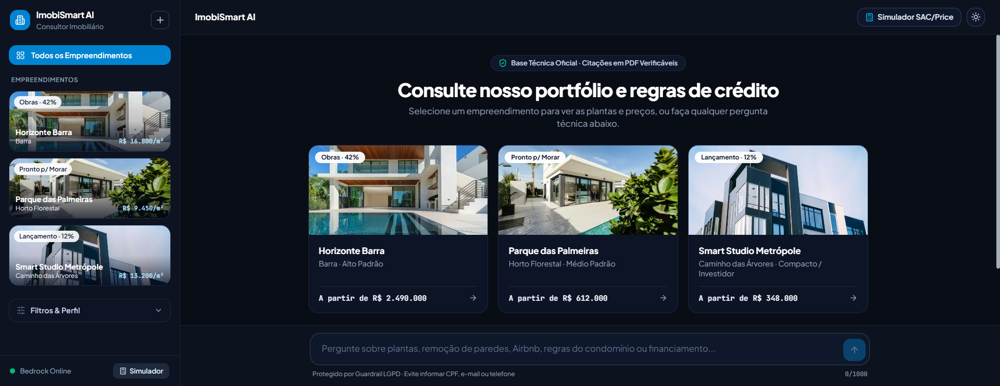
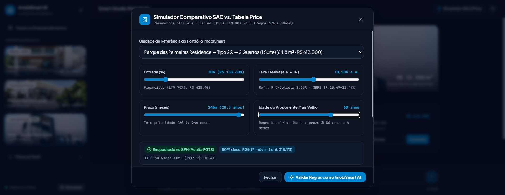
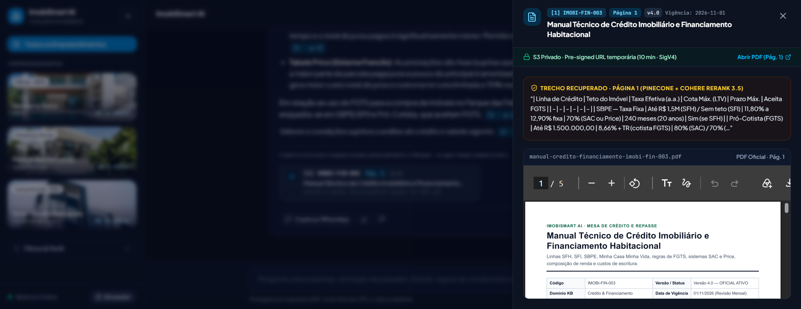

# 🎬 Evidências de QA & Demonstração — ImobiSmart AI

Este diretório reúne as gravações `.mp4` e capturas de tela geradas em auditoria end-to-end no Google Chrome contra a aplicação Next.js 15 + backend Serverless AWS (`us-east-1`, Amazon Bedrock Nova Pro + Pinecone Serverless + Cohere Rerank 3.5 + S3 Pre-signed URLs).

> **Dica para GitHub README / PRs:** você pode arrastar qualquer arquivo `.mp4` desta pasta diretamente para o editor do README ou de uma Issue/PR no GitHub para obter o player nativo embutido.

---

## 🎥 Gravações em Vídeo (`.mp4`)

| Vídeo | Escopo Validado | Resultado |
| :--- | :--- | :---: |
| [demo-01a-portfolio-empreendimentos.mp4](./demo-01a-portfolio-empreendimentos.mp4) | Carregamento inicial (`Bedrock Online`), galeria fotográfica dos 3 empreendimentos, troca entre *Horizonte Barra* (`EMP-HB-2027` · SFI), *Parque das Palmeiras* (`EMP-PP-2026` · Alvenaria Estrutural + SFH/FGTS) e *Smart Studio Metrópole* (`EMP-SM-2028` · Drywall + Airbnb) | **PASS** |
| [demo-01b-simulador-sac-price.mp4](./demo-01b-simulador-sac-price.mp4) | Simulador Comparativo SAC vs. Tabela Price: troca de tipologia (`SFI` ↔ `SFH` com 50% desc. RGI), slider de Entrada (`20% → 30%`, removendo alerta de LTV > 70% na Price) e slider de Idade (`35 → 60 anos`, aplicando automaticamente o teto bancário `80a6m → 246 meses`) | **PASS** |
| [demo-01c-filtros-perfil-darkmode.mp4](./demo-01c-filtros-perfil-darkmode.mp4) | Painel expansível *Filtros & Perfil* (`Corretor` → `Comprador`, seleção de 2 domínios Pinecone com badge `2 filtros ativos` na topbar), retorno à galeria completa e alternância *Dark Mode ↔ Light Mode* | **PASS** |
| [demo-rag-citacoes-pagina-pdf.mp4](./demo-rag-citacoes-pagina-pdf.mp4) | Consulta RAG real na AWS (`POST /api/chat` → `200`, `8.0s`), marcações inline `[1 · p.1]`, card de fonte oficial com código + `Pág. 1` + título + arquivo `.pdf` e abertura do `CitationDrawer` renderizando o PDF oficial via S3 Pre-signed URL direto em `#page=1` | **PASS** |

---

## 📸 Capturas de Tela (`.png`)

1. **Landing & Galeria Fotográfica (Dark Mode):** 
2. **Ficha Técnica do Empreendimento & Regras-Chave:** 
3. **Simulador SAC vs. Price (SFH + 30% Entrada + Teto 60 anos → 246m):** 
4. **Filtros Pinecone (`2 filtros ativos`) & Light Mode:** 
5. **Chat RAG com Badges Inline `[1 · p.1]` e Card de Fonte Oficial:** 
6. **Inspetor `CitationDrawer` com PDF Oficial na Página `#page=1`:** 

---

## ✅ Resumo da Auditoria de Rede & Segurança

- **HTTP / Rede:** 0 erros `4xx`/`5xx` em todas as requisições da sessão (`GET /`, `GET /api/health`, `POST /api/chat`, imagens `/_next/image` e PDF via S3 Pre-signed URL com `200 OK`).
- **Security Headers & CSP:** 0 violações de `Content-Security-Policy` (inclusive no `<iframe>` S3 em `frame-src`).
- **Backend Unit Tests:** `11/11 PASS` (`backend/tests/test_backend.py`) + TypeScript `strict` `0 erros`.
