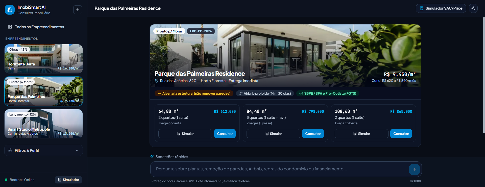
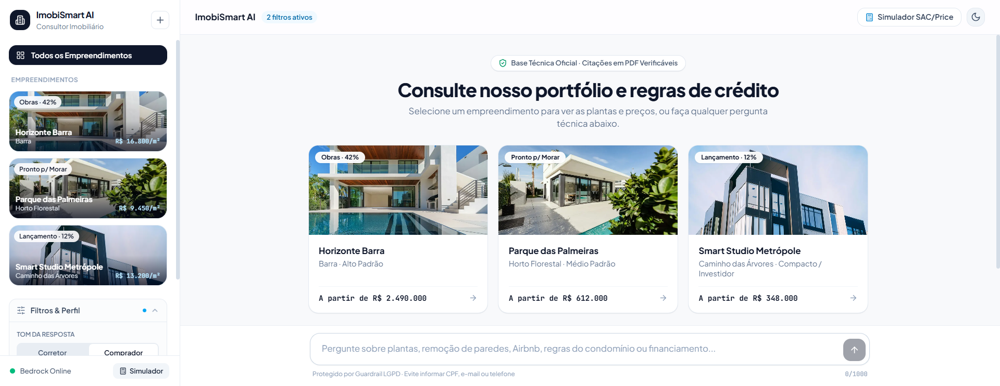
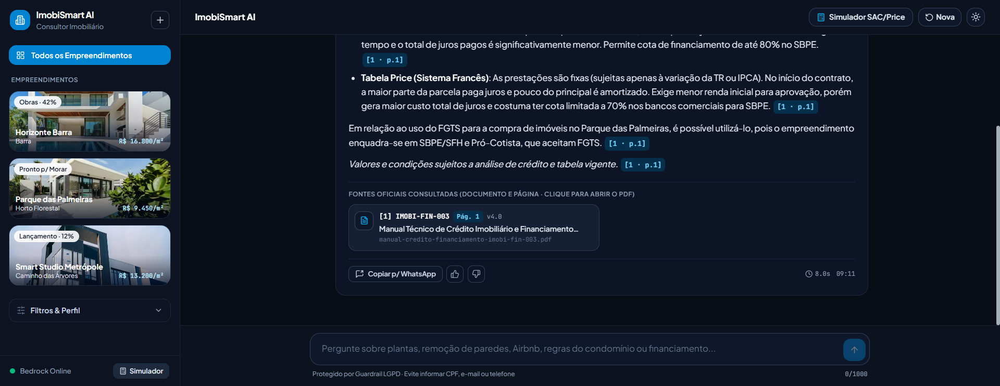
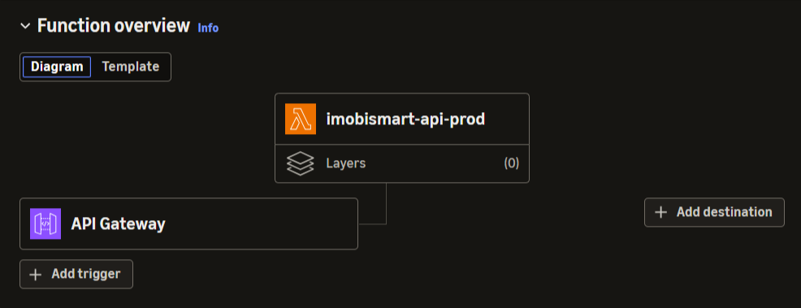
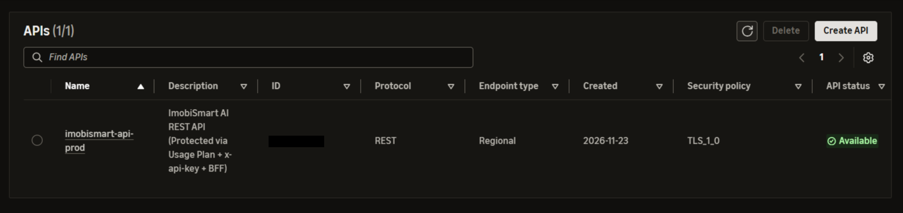
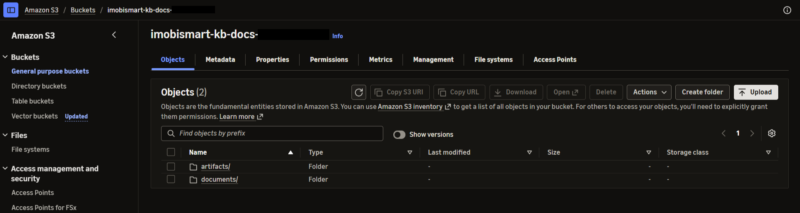
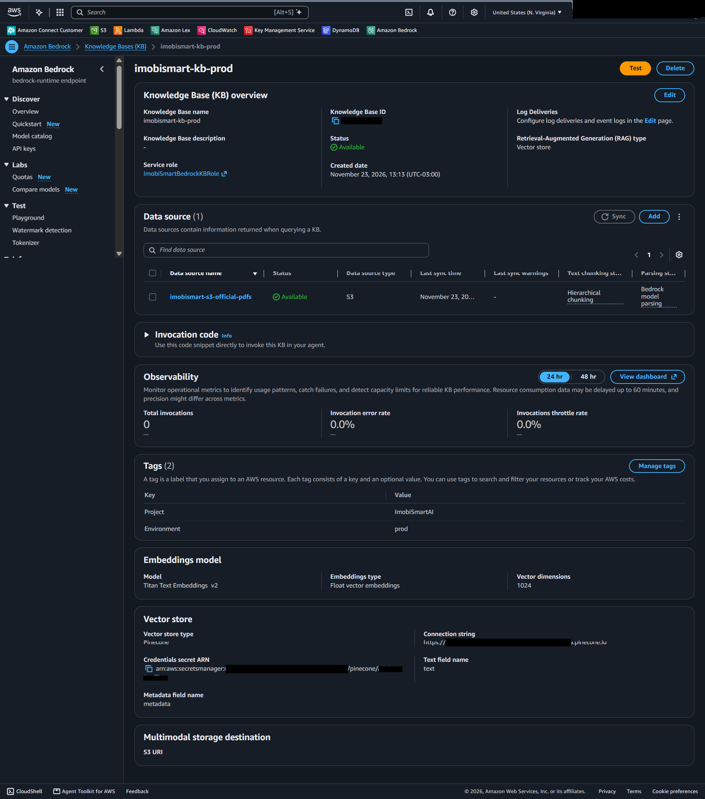
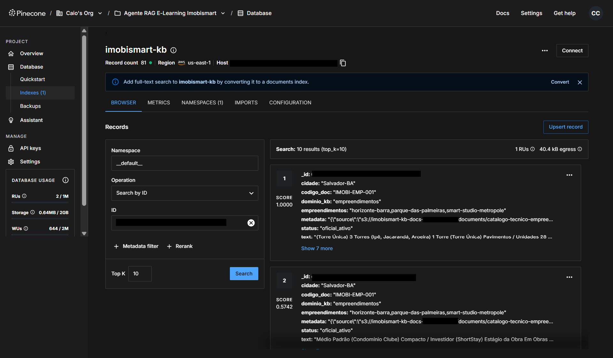
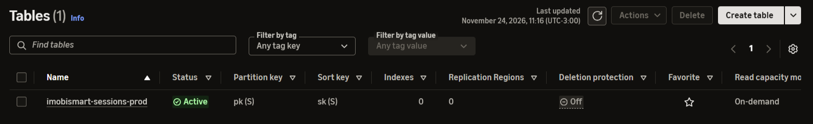

# 🎬 Evidências em Produção na AWS & QA — ImobiSmart AI

Este diretório reúne a demonstração em vídeo (hospedada no YouTube para manter o repositório Git leve) e as capturas de tela geradas em validação manual end-to-end contra a aplicação Next.js 15 + backend Serverless ativo na **AWS (`us-east-1`)** (Amazon Bedrock Nova Pro + Knowledge Base + Pinecone Serverless + Cohere Rerank 3.5 + Guardrail LGPD + S3 Pre-signed URLs + DynamoDB).

---

## 🎥 Demonstração Completa em Produção na AWS (YouTube)

| Gravação | Escopo Validado em Produção na AWS (`us-east-1`) | Resultado |
| :--- | :--- | :---: |
| [Demonstração Manual E2E em Produção na AWS (YouTube)](https://youtu.be/37uelSDcW_Q) | Teste manual completo contra o backend real na AWS: navegação do portfólio (3 empreendimentos), Simulador SAC vs. Tabela Price (com card determinístico no chat), filtros Pinecone/persona, consultas RAG multi-documento com citações por documento e página (`[1 · p.N]`), abertura inline do PDF oficial via S3 Pre-signed URL (`#page=N`) e proteção Guardrail | **PASS** |

---

## 📸 Capturas de Tela (`.png`)

1. **Landing & Galeria Fotográfica (Dark Mode):** 
2. **Ficha Técnica do Empreendimento & Regras-Chave:** 
3. **Simulador SAC vs. Price (SFH + 30% Entrada + Teto 60 anos → 246m):** 
4. **Filtros Pinecone (`2 filtros ativos`) & Light Mode:** 
5. **Chat RAG com Badges Inline e Card de Fonte Oficial:** 

*(O fluxo completo do `CitationDrawer` abrindo o PDF oficial na página exata `#page=N` pós-ajuste `0-based → 1-based` está registrado na [gravação completa em produção no YouTube](https://youtu.be/37uelSDcW_Q).)*

---

## ☁️ Evidências da Infraestrutura Provisionada (AWS `us-east-1` & Pinecone)

*(Account ID, IDs de recursos, ARNs de segredos e hosts privados foram tarjados para publicação em repositório aberto.)*

7. **AWS Lambda (`imobismart-api-prod` · Trigger API Gateway · Zero Layers):** 
8. **Amazon API Gateway REST (`imobismart-api-prod` · Regional · Protected via Usage Plan + `x-api-key` + BFF):** 
9. **Amazon S3 Privado (Prefixos isolados `artifacts/` e `documents/`):** 
10. **Amazon Bedrock Knowledge Base (`imobismart-kb-prod` · `ImobiSmartBedrockKBRole` · Hierarchical Chunking + FM Parsing + Titan Embed v2 `1024d`):** 
11. **Pinecone Serverless (`imobismart-kb` · `81` vetores · `0.64 MB / 2 GB` · `us-east-1` · Metadados escalares planos):** 
12. **Amazon DynamoDB (`imobismart-sessions-prod` · `Active` · `pk`/`sk` · `On-demand`):** 

---

## ✅ Resumo da Auditoria de Rede & Segurança

- **HTTP / Rede:** 0 erros `4xx`/`5xx` em todas as requisições da sessão (`GET /`, `GET /api/health`, `POST /api/chat`, imagens `/_next/image` e PDF via S3 Pre-signed URL com `200 OK`).
- **Security Headers & CSP:** 0 violações de `Content-Security-Policy` (inclusive no `<iframe>` S3 em `frame-src`).
- **Backend Unit Tests:** `12/12 PASS` (`backend/tests/test_backend.py`) + TypeScript `strict` `0 erros`.
